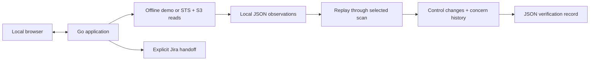

# S3 Buckets Auditor

A read-only Go tool for **S3 configuration review and remediation verification**. Checks bucket-policy public status and bucket-level Public Access Block, with a local UI, history, JSON exports and optional Jira handoff.

**What makes it useful:** concerns survive denied inspections and missing buckets. Each control compares against its last successful observation; a failed scan cannot make an old concern disappear. Verification records show original concerns, inspection gaps, individual flag changes and successful clearing evidence.

**Scope:** two configuration checks, not proof of effective public access. No ACL, account-level, access-point or object inspection. Unknown is never a pass.

## Try it

With Go **1.25.5+**:

```sh
go run .
```

Choose **Try the guided demo** for four example buckets. Then **Try the verification walkthrough**: concern → denied → missing → verified clear. Both are entirely offline. Select a stage in history and download its verification record. White/teal and true-black/teal themes are included. Stop with **Ctrl+C** in the launcher.

[Portable releases](https://github.com/theprideofwolves/S3-buckets-auditor/releases) need no Go installation. Use this source checkout for changes not yet released.

## How it works



- Eight workers, 30 seconds per bucket; UI scans have a three-minute deadline and 1,000-bucket limit.
- Replay is isolated by account/region and synthetic/live status. Missing observations retain unresolved concerns; recurrence starts a new episode.
- Atomic history replacement; durable Jira create intent prevents blind retries after uncertain delivery. No stored Jira tokens or automatic ticket closure.
- Server-rendered HTML, AWS SDK for Go v2, standard-library HTTP and JSON storage. No frontend build or database server.

## Recorded results

**47 top-level tests / 129 named leaf cases passed; 79.29% Go statement coverage.** All 48 policy/flag matrix cases and 10 unusable-response cases passed. Packaged UI/CLI and offline Chromium checks passed. [Results, raw evidence and synthetic timings](docs/results/2026-11-10-windows/README.md) · [Functional coverage map](docs/VALIDATION.md).

These are local fake-service results, not live AWS/Jira accuracy or production throughput.

## Verify and explain

Go, Python 3 and a C compiler for the race detector:

```sh
python .github/scripts/check.py
```

Runs race tests, vet, build and offline UI/CLI smoke checks with isolated credentials. Fake services **do not prove live compatibility**.

[Workflow and example](docs/VERIFICATION.md) · [Architecture](architecture.md) · [Interview guide](interviewprep.md) · [Manual checklist](docs/TESTING.md) · [Usage](docs/USAGE.md)
